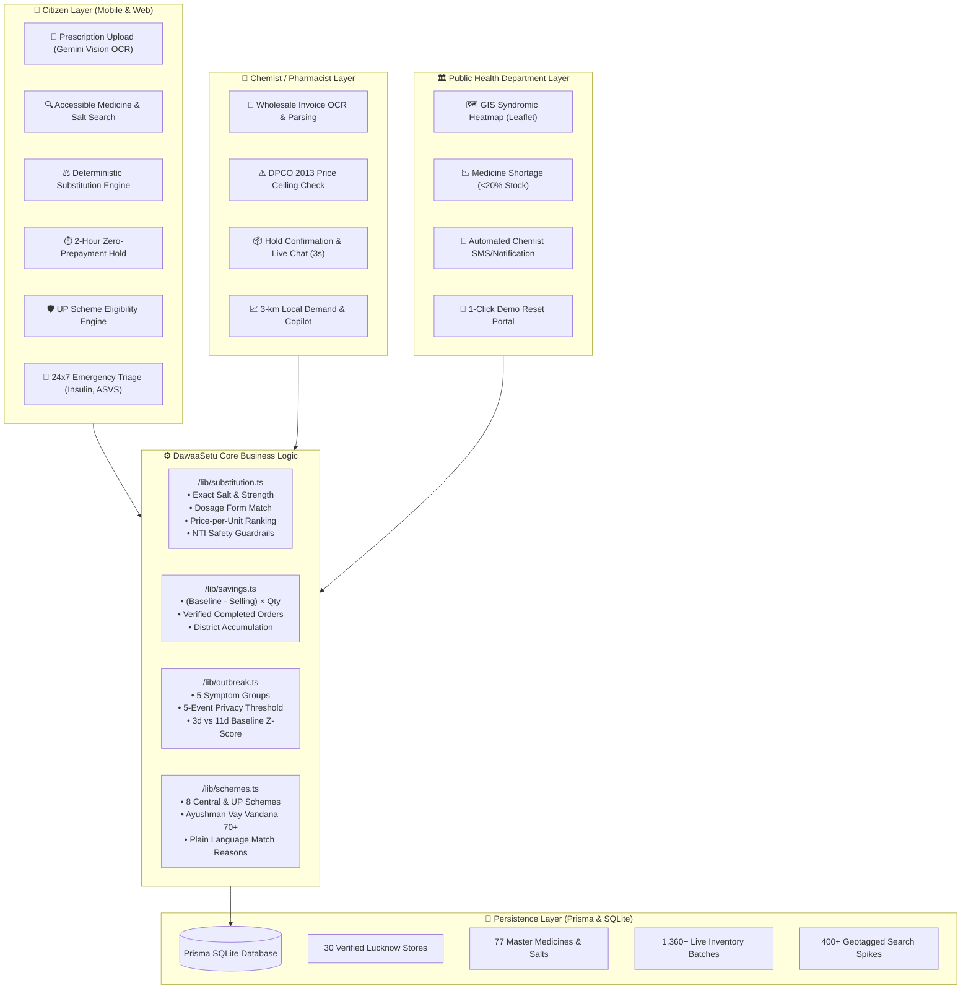

# DawaaSetu (दवा सेतु) 🏥
### AI-Powered Medicine Discovery, Jan Aushadhi Generic Substitution & Syndromic Outbreak Surveillance for Uttar Pradesh

> **Built for AI Kaushal 24h Hackathon 2026** &bull; Production-grade Next.js 14, TypeScript, Prisma, SQLite, TailwindCSS, Gemini 2.0 Flash Vision, and Leaflet GIS.

---

## 🌟 Executive Summary

In Uttar Pradesh, out-of-pocket expenditure (OOPE) on medicines accounts for over 65% of household healthcare costs. Simultaneously, citizens struggle to locate in-stock critical medicines in their immediate neighborhood, while over **1,800 subsidized PM Jan Aushadhi generics** (priced 70–85% lower) sit underutilized due to lack of transparent brand-to-salt substitution and fear of quality mismatch. 

**DawaaSetu (दवा सेतु)** bridges this divide with three dedicated, interconnected portals:
1. **Citizen Portal (`/citizen`, `/search`, `/prescription`, `/orders`, `/schemes`)**: Instant medicine discovery, Gemini Vision prescription OCR with audio explainer, deterministic salt-matching substitution engine, zero-prepayment 2-hour pharmacy holds, and UP government scheme eligibility.
2. **Chemist Portal (`/shop/dashboard`, `/shop/orders`, `/shop/upload-bill`)**: Wholesale purchase invoice OCR in 30 seconds, DPCO 2013 price ceiling compliance checker, 2-hour hold confirmation with live chat, and a 3-km unmet demand radar.
3. **Health Department Portal (`/admin/heatmap`, `/impact`, `/admin/reset`)**: Real-time syndromic surveillance detecting disease surges (fever, gastro, respiratory) from OTC pharmacy demand spikes with differential privacy (5-event suppression), critical medicine shortage radar (<20% store coverage), and 1-click advisory dispatch.

---

## 🏛️ System Architecture



---

## 🚀 Key Differentiators & Features

### 1. Deterministic Generic Substitution Engine (`/lib/substitution.ts`)
- **Strict Clinical Equivalence**: Matches identical active chemical entities (salts), exact strengths, and exact dosage forms. Never substitutes across different forms (e.g. tablet vs. syrup).
- **Price-per-Unit Ranking**: Normalizes prices by unit (price / packSize) so blister packs of 10, 14, and 15 compare fairly.
- **Narrow Therapeutic Index (NTI) Safety Guardrails**: Detects critical drugs where minute dosage variations cause toxicity (Levothyroxine, Warfarin, Phenytoin, Lithium). Immediately suppresses automated promotion and triggers an amber clinical warning: *"This medicine requires careful titration. Consult your physician before switching brands."*
- **Explainable Classification**: Clearly categorizes options as **PM Jan Aushadhi** (green badge), **Generic**, or **Cheaper Brand**, detailing exact ₹ and % savings.

### 2. AI Prescription OCR & Bilingual Audio Explainer (`/prescription`)
- Multimodal OCR powered by **Gemini 2.0 Flash Vision** with automatic offline fallback to sample data.
- Extracts brand names, active salts, strength, frequency (e.g., 1-0-1), duration, and plain-language instructions.
- Includes browser Web Speech synthesis explaining the prescription aloud in **Hindi** and **English** for low-literacy citizens.

### 3. Zero-Prepayment 2-Hour Chemist Hold (`/orders`, `/shop/orders`)
- Citizens reserve necessary medicines at nearby pharmacies without entering credit cards or UPI prepayment.
- A live synchronized **2-hour countdown timer** temporarily decrements available stock, preventing wasted travel and out-of-stock disappointments.
- Integrated **3-second polling bilateral chat** with one-tap quick reply chips (*"Is generic available?"*, *"When will it be ready?"*).

### 4. Chemist Wholesale Invoice OCR & Inventory Sync (`/shop/upload-bill`)
- Pharmacists upload wholesale paper invoices; AI extracts product name, batch number, expiry date, purchase rate, and MRP in under 30 seconds.
- **DPCO 2013 Price Ceiling Compliance**: Flags medicines priced above government ceiling prices to avoid legal penalties.
- Updates inventory batch records, flags items expiring within 60 days, and analyzes 7-day unmet search demand within 3 km.

### 5. Health Department Syndromic Outbreak Heatmap (`/admin/heatmap`)
- Aggregates geotagged medicine searches and completed orders into 5 symptom-signal groups: **Fever** (Paracetamol), **Gastro** (ORS, Ondansetron), **Respiratory** (Cough syrups, Azithromycin), **Skin**, and **Other**.
- **Differential Privacy Threshold**: Suppresses any area cell with fewer than 5 events (`PRIVACY_THRESHOLD = 5`) to protect citizen confidentiality.
- Calculates 3-day surge ratios against 11-day baselines, highlighting anomalous clusters (e.g., Chowk fever surge: 2.8x baseline) for early epidemic intervention before hospital admissions spike.
- Tracks district-level critical medicine shortages (<20% store availability) and dispatches broadcast advisories to chemists.

### 6. UP Healthcare Schemes Eligibility Engine (`/schemes`)
- Evaluates citizen demographic profile (age, district, income, category, pregnancy, chronic illness) against 8 central and UP state schemes:
  - *Ayushman Vay Vandana (70+ Senior Universal ₹5L Cover)*
  - *PM-JAY (Ayushman Bharat)*
  - *Mukhyamantri Jan Arogya Yojana (UP)*
  - *PMSMA (Pradhan Mantri Surakshit Matritva Abhiyan)*
  - *National Programme for Prevention and Control of NCDs*
  - *UP Essential Drug List (Free District Hospital Medicines)*
  - *PMBJP (Pradhan Mantri Bhartiya Janaushadhi Pariyojana)*
  - *Rashtriya Bal Swasthya Karyakram (RBSK)*
- Explains qualifying reasons in clear, plain language with official application links and required documents.

### 7. Accessibility & Offline Inclusivity
- **Large-Text Scaling (A+)**: Global 115% proportional scaling for senior citizens.
- **High-Contrast Mode**: Crisp borders, deep contrasts, and high-visibility focus indicators.
- **Full Hindi & English Localization**: 100% translated UI with persistent `localStorage` synchronization.
- **Keyboard Navigation**: Accessible combobox (`role="combobox"`, `role="listbox"`, ArrowUp, ArrowDown, Enter, Escape).

### 8. 24x7 Emergency Medicine Radar
- Quick-access emergency triage modal for critical life-saving items:
  - **Human Insulin** (Regular & 30/70)
  - **Anti-Snake Venom Serum (ASVS Polyvalent)**
  - **Anti-Rabies Vaccine (ARV & Rabies Immunoglobulin)**
  - **Epinephrine (Adrenaline 1:1000)**
- Displays nearest 24x7 facilities (KGMU Trauma Centre, Balrampur Hospital, Lohia Institute) with verified cold chain storage badges, real-time stock counts, distances, and 1-tap call/directions links.

---

## 🛠️ Quickstart & Local Setup

### Prerequisites
- Node.js 18+ or 20+
- npm or yarn

### Installation Steps

```bash
# 1. Clone repository & install dependencies
git clone <repo-url>
cd "AI Kaushal"
npm install

# 2. Environment Variables Setup
# Create .env file with your GEMINI_API_KEY (optional; system includes offline fallback mock)
cat <<EOF > .env
DATABASE_URL="file:./dev.db"
GEMINI_API_KEY="your-gemini-api-key"
EOF

# 3. Database Migration & Seed
# Seeds 30 Lucknow pharmacies, 77 master medicines, 1,360+ inventory batches, and outbreak surge data
npx prisma db push
npm run prisma:seed

# 4. Start Development Server
npm run dev
```

Visit **`http://localhost:3000`** in your browser.

---

## 🧪 Automated Testing & Verification

The test suite validates deterministic substitution logic, safety guardrails, savings calculations, scheme eligibility algorithms, and epidemiological outbreak detection:

```bash
# Run all unit tests
npm test

# Type checking
npx tsc --noEmit

# Production build test
npm run build
```

**Test Coverage Summary**:
- `lib/__tests__/substitution.test.ts`: Exact salt match, different strength rejection, form match, NTI guardrail suppression, price-per-unit ranking.
- `lib/__tests__/savings.test.ts`: Auditable formula tests, ceiling/floor at 0, lifetime savings accumulation on completed orders.
- `lib/__tests__/schemes.test.ts`: Senior citizen auto-derivation, Ayushman Vay Vandana 70+ matching, income threshold checks, pregnancy eligibility.
- `lib/__tests__/outbreak.test.ts`: 5-event privacy suppression, ratio calculations, anomaly alert thresholds (>1.5x, >2.5x), shortage detection (<20% stock).

---

## 🎭 5-Minute Hackathon Demo Script for Judges

| Time | Persona | Action & Route | What to Point Out to Judges |
| :--- | :--- | :--- | :--- |
| **0:00 - 1:00** | **Citizen** | `/` &rarr; `/prescription` | 1. Show the full-bleed landing page and live ₹18.45L+ savings counter.<br/>2. Click **Scan Rx** or upload a prescription.<br/>3. Show Gemini Vision OCR extracting *Dolo 650*, *Telma 40*, *Pan 40* into structured tables.<br/>4. Click the **Listen in Hindi (बोलकर सुनें)** audio button. |
| **1:00 - 2:00** | **Citizen** | `/search?q=Telmisartan` | 1. Show deterministic substitution: Telma 40 (₹145) &rarr; Jan Aushadhi Telmisartan (₹18) &rarr; **88% Savings**.<br/>2. Highlight price-per-unit normalization.<br/>3. Show NTI warning on Thyroxine or Warfarin: *"Requires careful dosing..."* |
| **2:00 - 2:45** | **Citizen** | `/store/[id]` &rarr; `/orders` | 1. Add to cart from nearby *Gupta Medicos* (1.2 km away).<br/>2. Click **Hold for 2 Hours (No Prepayment)**.<br/>3. Point out the live countdown timer and 4-step status stepper.<br/>4. Send a message: *"Is generic available?"* via live 3s polling chat. |
| **2:45 - 3:30** | **Chemist** | `/shop/dashboard` &rarr; `/shop/upload-bill` | 1. Switch role to **Chemist** in navbar.<br/>2. Open Incoming Holds and click **Confirm** and **Mark Ready**.<br/>3. Upload wholesale bill photo: AI extracts 12 items with batch and expiry.<br/>4. Show DPCO ceiling price compliance warning and 3-km unmet demand radar. |
| **3:30 - 4:15** | **Health Dept** | `/admin/heatmap` &rarr; `/impact` | 1. Switch to **Health Dept** role.<br/>2. Show GIS Leaflet syndromic heatmap.<br/>3. Click the red alert over **Chowk**: *"Possible rise in fever-related demand: 2.8x baseline over 3 days."*<br/>4. Emphasize differential privacy: cells with &lt;5 events suppressed.<br/>5. Click **Send Advisory to Chemists** and view Statewide Impact chart. |
| **4:15 - 5:00** | **Citizen / Admin**| `/schemes` &rarr; `/admin/reset` | 1. Open UP Schemes: input age 72 &rarr; instant qualification for **Ayushman Vay Vandana 70+** with plain-language reasons.<br/>2. Click **Demo Guide** tour or **1-Click Reset** at `/admin/reset` to show pristine repeatability. |

---

## 📁 Repository Structure

```
AI Kaushal/
├── app/
│   ├── admin/
│   │   ├── heatmap/page.tsx      # Leaflet syndromic surveillance map & shortage alerts
│   │   └── reset/page.tsx        # 1-Click demo database reset portal
│   ├── api/
│   │   ├── admin/reset/route.ts  # Demo state refresh API
│   │   ├── bill/extract/route.ts # Gemini Vision invoice OCR with DPCO validation
│   │   ├── outbreak/route.ts     # Differential privacy outbreak metrics
│   │   ├── rx/extract/route.ts   # Gemini Vision prescription parser
│   │   └── schemes/route.ts      # Profile evaluation API
│   ├── citizen/page.tsx          # Citizen portal hub
│   ├── impact/page.tsx           # Statewide savings counter & district charts
│   ├── orders/page.tsx           # 2-hour hold status & bilateral chat
│   ├── prescription/page.tsx     # Rx upload & audio reader
│   ├── schemes/page.tsx          # UP government schemes eligibility
│   ├── search/page.tsx           # Medicine search & nearby stock
│   ├── shop/
│   │   ├── dashboard/page.tsx    # Chemist dashboard & copilot
│   │   ├── orders/page.tsx       # Incoming holds & inventory decrement
│   │   └── upload-bill/page.tsx  # Wholesale invoice OCR review
│   ├── store/[id]/page.tsx       # Store inventory & in-store search
│   └── page.tsx                  # World-class full-bleed landing page
├── components/
│   ├── DemoGuideTour.tsx         # Floating 6-step interactive demo guide
│   ├── MedicineEmergencyModal.tsx# 24x7 emergency triage radar
│   ├── Navbar.tsx                # Glassmorphic header with accessibility & SOS triggers
│   ├── SearchAutocomplete.tsx    # Accessible combobox with keyboard navigation
│   └── SubstitutePanel.tsx       # Deterministic generic substitution card
├── lib/
│   ├── outbreak.ts               # Outbreak anomaly score & shortage algorithms
│   ├── savings.ts                # Transparent savings accounting formulas
│   ├── schemes.ts                # Deterministic UP healthcare schemes engine
│   ├── substitution.ts           # Clinical substitution & NTI safety engine
│   └── i18n.tsx                  # Localization & accessibility state
└── prisma/
    ├── schema.prisma             # SQLite schema (Stores, Medicines, Inventory, Events)
    └── seed.ts                   # Comprehensive Lucknow dataset seed script
```

---

## 📜 Ethical & Safety Safeguards
1. **Clinical Disclaimer**: DawaaSetu clearly states on all substitution panels that generics possess identical active ingredients and potency, but patients must verify with their physician or licensed pharmacist before switching.
2. **Narrow Therapeutic Index (NTI)**: Never auto-substitutes critical titration medications (Thyroxine, Lithium, Warfarin, Phenytoin).
3. **Surveillance Confidentiality**: OTC demand signals are strictly aggregated at the municipal area level; any cell with fewer than 5 search/purchase events is strictly suppressed from maps and exports.
4. **Offline Resilience**: Full functional fallback ensures zero dependency on external network APIs during critical pharmacy lookups.

---

Built with ❤️ for the citizens of Uttar Pradesh.
